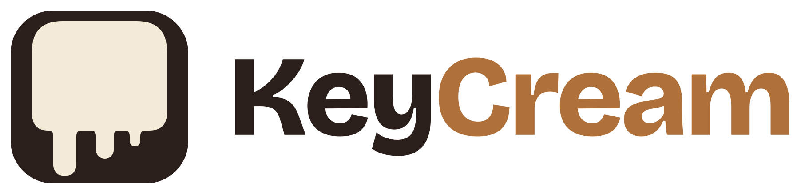

<p align="center">
  <picture>
    <source media="(prefers-color-scheme: dark)" srcset="assets/keycream-logo-dark.svg">
    
  </picture>
</p>

<p align="center">
  Mechanical keyboard sounds for your Mac.<br>
  A lightweight menu bar app that plays a satisfying click for every keystroke.
</p>

<p align="center">
  <a href="https://github.com/halitsever/keycream/releases/latest"></a>
  <a href="https://github.com/halitsever/keycream/actions/workflows/release.yml"></a>
  
  <a href="LICENSE"></a>
</p>

## Features

- **7 sound packs**: NovelKeys Cream, Cherry MX Black, Blue, Brown and Red, Everglide Crystal Purple and Oreo
- **Every key sounds right**: letters, Space, Enter, Backspace and modifiers each use their own recording
- **Even volume**: each key's sound is normalized, so no single key is suddenly louder than the rest
- **Natural typing**: holding a key doesn't machine-gun the sound, and fast typing overlaps instead of cutting off
- **Lives in the menu bar**: no Dock icon, starts at login, remembers your settings
- **12 languages**: follows your Mac's language, or pick one from the menu
- **Private**: reads only which physical key was pressed, never what you type, and makes no network connections

## Installation

1. Download **KeyCream-x.y.z.zip** from the [latest release](https://github.com/halitsever/keycream/releases/latest).
2. Unzip it and drag **KeyCream** into your **Applications** folder.
3. Open it. KeyCream isn't notarized by Apple yet, so macOS blocks the first launch:
   - Open **System Settings → Privacy & Security**, scroll down and click **Open Anyway** next to the KeyCream message, then confirm.
   - Or run this once in Terminal:
     ```bash
     xattr -dr com.apple.quarantine /Applications/KeyCream.app
     ```
4. Allow keyboard access when asked: **System Settings → Privacy & Security → Input Monitoring → KeyCream**. Sounds start within a few seconds, no restart needed.

KeyCream runs on macOS 14 Sonoma or later, on both Apple Silicon and Intel Macs.

> [!NOTE]
> After updating to a new release, macOS may ask for Input Monitoring access again. If KeyCream stays silent after an update, remove it from the Input Monitoring list and add it back.

## Usage

Click the KeyCream icon in the menu bar:

| Menu item | What it does | Default |
|---|---|---|
| Sounds On | Turns key sounds on or off | On |
| Volume | Low, Medium or High | High |
| Sound Pack | Chooses which switch you hear | NovelKeys Cream |
| Open at Login | Starts KeyCream when you log in | On |
| Language | System language or one of 12 languages | System |

Your choices are saved and survive restarts.

## Sound packs

All bundled packs come from the open-source [Mechvibes](https://github.com/hainguyents13/mechvibes) project and are MIT-licensed. See [THIRD_PARTY_NOTICES.md](THIRD_PARTY_NOTICES.md) for sources and credits.

KeyCream reads the Mechvibes pack format, so other packs can be added under `Resources/SoundPacks/`. See [CONTRIBUTING.md](CONTRIBUTING.md#sound-packs) for the license requirements.

## Building from source

Requires macOS 14 or later and Xcode 15 or later.

```bash
git clone https://github.com/halitsever/keycream.git
cd keycream
./build.sh
open build/KeyCream.app
```

`UNIVERSAL=1 ./build.sh` builds for Apple Silicon and Intel together. Every push to `main` builds and publishes a new release through [GitHub Actions](.github/workflows/release.yml).

## How it works

- A listen-only `CGEventTap` reports key-down events. Key repeats from holding a key are ignored.
- The macOS key code is translated to the PC scan code that Mechvibes packs use, which selects the sound.
- All sounds are decoded into memory when a pack loads, filtered, trimmed and loudness-normalized, so playback starts instantly.
- `AVAudioEngine` plays them through a pool of player nodes, so quick keystrokes can overlap.

## Contributing

Bug reports, translations and pull requests are welcome. Please read [CONTRIBUTING.md](CONTRIBUTING.md) and the [Code of Conduct](CODE_OF_CONDUCT.md). Security issues go through [SECURITY.md](SECURITY.md).

## License

KeyCream is released under the [MIT License](LICENSE). Bundled sound packs keep their own licenses, listed in [THIRD_PARTY_NOTICES.md](THIRD_PARTY_NOTICES.md).
